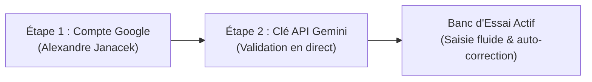

# 🧠 T9 Autocorrect AI — Extension Google Chrome & Userscript

[-blue.svg)](manifest.json)
[](https://aistudio.google.com/)
[](#-installation-de-lextension-google-chrome)
[](#)

> **Autocorrecteur contextuel et sémantique universel propulsé par l'IA Google Gemini pour tout le Web.**  
> Fini les dictionnaires rigides : l'IA analyse l'intention réelle, la phonétique, l'argot, les inversions de frappe et la grammaire pour restituer un français impeccable, 100% automatiquement après 1 seconde de pause.

---

## 📑 Sommaire
- [Ce que fait le projet](#-ce-que-fait-le-projet)
- [Installation de l'Extension Google Chrome (Recommandé)](#-installation-de-lextension-google-chrome-recommandé)
- [Fonctionnalités clés](#-fonctionnalités-clés)
- [Parcours de configuration (Entonnoir en 2 Étapes)](#-parcours-de-configuration-entonnoir-en-2-étapes)
- [Restauration de mot d'origine & Dictionnaire](#-restauration-de-mot-dorigine--dictionnaire)
- [Sauvegarde Cloud & Compte Google](#-sauvegarde-cloud--compte-google)
- [Architecture & Fichiers](#-architecture--fichiers)

---

## 🎯 Ce que fait le projet

Contrairement aux correcteurs classiques limités à des listes statiques de mots :
1. **Compréhension du sens profond** : Même avec des phrases lourdement déformées ou écrites en phonétique rapide, l'IA reconstitue la phrase exacte voulue.
   - *« j'ecri makl »* ➔ **« J'écris mal »**
   - *« je susi content »* ➔ **« Je suis content »**
   - *« Je vois du chameau dans le d'user »* ➔ **« Je vois des chameaux dans le désert. »**
   - *« alex tu vas comment aujoudui »* ➔ **« Alex, tu vas comment aujourd'hui ? »**
   - *« salu sa vas vie te toi ? »* ➔ **« Salut, ça va bien et toi ? »**
2. **Correction 100% Automatique** : Aucun raccourci ni bouton requis au quotidien. Dès que vous arrêtez de taper pendant **1 seconde**, l'IA corrige le texte de façon fluide.
3. **Surlignage en jaune & Immunité au clic** : Les mots modifiés sont temporairement surlignés en jaune clair. Si l'IA a transformé un mot que vous vouliez garder (argot, prénom, jargon), un simple clic dessus restaure instantanément votre mot d'origine et l'ajoute à votre dictionnaire personnel pour qu'il ne soit plus jamais touché.
4. **Compatibilité universelle** : Fonctionne sur `<input>`, `<textarea>` et les éditeurs riches `[contenteditable]` (Gmail, Notion, Slack, Discord, WhatsApp Web, ChatGPT, Claude, etc.).

---

## 🚀 Installation de l'Extension Google Chrome (Recommandé)

L'extension fonctionne sous **Google Chrome Manifest V3**. Elle ne nécessite aucun outil de compilation :

1. Ouvrez **Google Chrome**.
2. Dans la barre d'adresse, saisissez : `chrome://extensions` et validez.
3. En haut à droite, activez le bouton bascule **« Mode développeur »**.
4. En haut à gauche, cliquez sur le bouton **« Charger l'extension non empaquetée »**.
5. Sélectionnez le dossier du projet :
   ```text
   c:\Users\Alex\Desktop\tampermonkey-t9-autocorrect
   ```
6. **C'est prêt !** L'extension apparaît dans votre barre d'outils Chrome. Cliquez sur l'icône de l'extension pour ouvrir le panneau rapide ou accédez aux **Options** pour le banc d'essai complet.

---

## 🧭 Parcours de configuration (Entonnoir en 2 Étapes)

Pour garantir une expérience optimale et sécurisée, la saisie nécessite d'avoir validé les deux étapes préalables :



1. **Étape 1 — Connexion au Compte Google** :
   - Association sécurisée au profil officiel.
   - Synchronisation automatique de vos paramètres et de votre dictionnaire sur votre compte Google (`chrome.storage.sync`).
2. **Étape 2 — Clé API Google Gemini** :
   - Clé gratuite obtenue en 30 secondes sur [Google AI Studio](https://aistudio.google.com/).
   - Test et validation en direct avec sélection automatique du meilleur modèle disponible (`gemini-2.5-flash`, `gemini-2.0-flash`, etc.).
3. **Banc d'Essai Déverrouillé** :
   - Dès les 2 étapes franchies, l'entonnoir supérieur disparaît pour vous offrir une interface épurée dédiée au test de correction en temps réel.

---

## ⚡ Restauration de mot d'origine & Dictionnaire

Lorsqu'une phrase est corrigée :
- Un algorithme d'alignement fin (LCS) associe chaque mot corrigé au mot brut que vous aviez saisi.
- Les mots modifiés sont subtilement surlignés en jaune clair.
- **Rétablir mon mot d'origine** : Cliquez sur le mot jaune ou sur la bannière de révision. Deux actions sont exécutées instantanément :
  1. Votre mot initial est remis à sa place dans le texte.
  2. Il est enregistré dans votre dictionnaire personnel et synchronisé avec votre compte Google. L'IA ne le modifiera plus jamais lors des futures frappes.
- **Gestionnaire JSON** : Exportez et importez votre dictionnaire en un clic via les boutons dédiés.

---

## ☁️ Sauvegarde Cloud & Compte Google

- **Synchronisation native** : Utilise `chrome.storage.sync` de Chrome. Vos données (clé API, dictionnaire, options) sont associées à votre profil Google et restaurées automatiquement sur tout ordinateur où vous vous connectez avec votre compte Chrome.
- **Coffre Cloud** : Fonction d'exportation / réimportation manuelle disponible en cas de besoin de sauvegarde locale.

---

## 📂 Architecture & Fichiers

```text
tampermonkey-t9-autocorrect/
├── manifest.json         # Spécification Manifest V3 de l'extension Chrome
├── background.js         # Service Worker Chrome (Appels API Gemini, stockage sync, menus)
├── content.js            # Script injecté sur tout le Web (écoute 1s, diff, overlay jaune, clics)
├── content.css           # Feuilles de style pour le surlignage jaune et les menus flottants
├── popup.html / popup.js # Fenêtre popup rapide dans la barre d'outils Chrome
├── options.html / .js    # Page de configuration complète et Banc d'Essai interactif
├── icons/                # Icônes de l'extension (16x16, 32x32, 48x48, 128x128)
├── user-profile.png      # Photo de profil Google officielle
├── test-page.html        # Page de test autonome
├── t9-autocorrect.user.js# Version alternative pour script Tampermonkey
└── README.md             # Guide officiel d'installation et de fonctionnement
```

---

## 💡 Remarque pour Tampermonkey

Si vous préférez exécuter le projet en tant que Userscript dans Tampermonkey plutôt qu'en extension Chrome native, le fichier [`t9-autocorrect.user.js`](t9-autocorrect.user.js) reste 100% fonctionnel et maintenu avec les mêmes algorithmes de détection et d'immunité.
